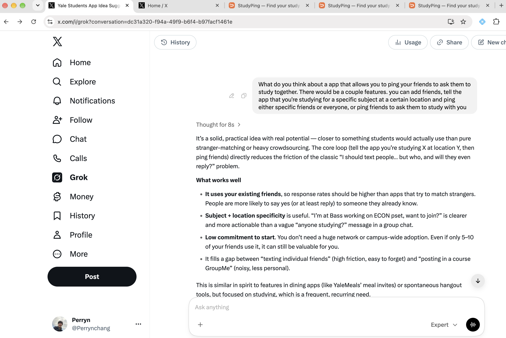
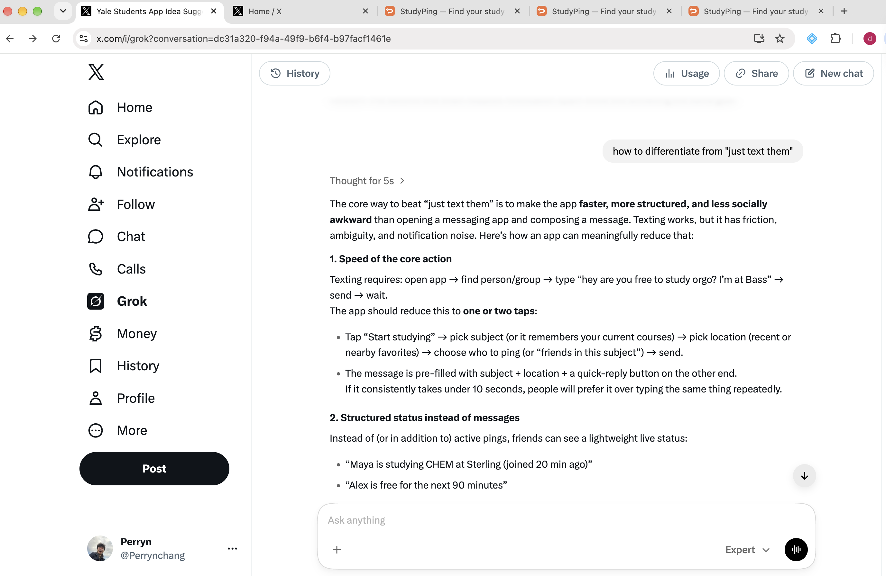

# StudyPing

## Use of Grok

Grok was used during concept exploration and product refinement. The conversations below document the original idea—pinging friends to study a specific subject at a specific place—and feedback on reducing coordination through quick actions, structured replies, and visible study status. These ideas informed StudyPing’s session creation and invitation flows. The submitted prototype also supports open groups so students can meet classmates beyond their existing friend circle.

**Exploring the original study-with-friends concept**



**Refining the experience and its value beyond texting**



Grok’s role in this submission was product ideation and feedback. The application does not call the Grok API or require an API key.

## Demo video

[Watch the StudyPing screen recording (MOV)](Screen%20Recording%202026-11-17%20at%207.40.54%E2%80%AFPM.mov)

The recording is included in this submission folder and shows the app in use.

## Overview

**Find your study people today.**

StudyPing is a responsive web app that helps Yale students find or organize small study groups, now or later today. Students choose their courses, browse relevant sessions, and join a group with a clear time, place, study style, and available spots. They can welcome classmates or keep a session within their friend circle.

The problem is everyday coordination: knowing whom to ask, whether they are available, what they are studying, and where to meet. StudyPing brings those details into one shared session view. Open classmate groups also give students a way to participate without already knowing the host.

This hackathon submission is a working, local interactive prototype with fictional activity. Its core flows can be evaluated without an account or backend setup.

## What the app does

| Feature                 | Student experience                                                                                                                                                                                                                                            |
| ----------------------- | ------------------------------------------------------------------------------------------------------------------------------------------------------------------------------------------------------------------------------------------------------------- |
| Course-based discovery  | Select study interests in **My courses**. Browse **Now** and **Later today**, filter by course, or search by course, host, location, task, or note.                                                                                                           |
| Open and private groups | Join **Classmates welcome** sessions without a friend request, or create **Friends only** sessions for an existing circle.                                                                                                                                    |
| Simple session creation | Choose a course, location, **Quiet study** or **Work together**, and a start time. Defaults are one hour and four people, including the host. **Additional options** provides duration, group sizes of 2/4/6, a task, a meeting note, and friend invitations. |
| Clear commitments       | See who has joined and how many spots remain. Joining saves a group spot; leaving releases it. Pending invitations and **Maybe** replies do not reserve spots.                                                                                                |
| Invitations and chat    | Invite selected friends, respond with quick replies, and coordinate in session chat. Chat is available to attending participants. All communication is simulated locally in this prototype.                                                                   |
| Personal session list   | Return to hosted or joined groups in **Sessions**. Schedule a later group without ending an ongoing one, and cancel a hosted plan when needed. Overlapping hosted sessions are prevented.                                                                     |
| Campus locations        | View approximate buildings for current sessions on **Map**, or follow links to Yale’s official study-space guide and room reservations.                                                                                                                       |
| Friends and focus       | Manage demo friend requests and use a 25- or 50-minute focus timer. Example study-history metrics are labeled as sample data.                                                                                                                                 |

Scheduling uses New Haven time (`America/New_York`), including daylight-saving changes. Scheduled sessions become current at their start time, and expired or ended sessions cannot be joined. Near midnight, **Later today** may have no remaining time slots.

## Run locally

**Requirements:** Node.js 22 or newer and npm.

From the project directory:

```bash
npm ci
npm run dev
```

Open the local URL printed by Vite, normally `http://localhost:5173`. The app opens as the demo profile **Perryn Chang**, with sample courses, people, and sessions. No credentials, environment variables, or external services are required.

To run automated checks and preview the production build:

```bash
npm test
npm run build
npm run preview
```

The build command checks TypeScript and writes the static application to `dist/`. Fonts and illustrations are bundled locally.

## Suggested evaluation walkthrough

1. On **Campus**, open **My courses** to see how course selection controls the feed.
2. Find Nora’s **Organic Chemistry · Exam practice, together** session under **Now**. Select **Join** to save a spot without adding Nora as a friend.
3. Check the time, meeting place, and participants. Open **Chat** to see the meeting instructions and send a local demo message.
4. Close the session view and select **Start studying**. Choose **Later today**, a time, and **Classmates welcome**, then select **Schedule session**.
5. Find the new group under **Later today** or return to it through **Sessions**.

**Reset demo**, available in profile/settings and the footer’s **Demo guide**, restores the starting scenario with fresh session times. To explore invitations, select a friend under **Additional options** when creating a session; **Send demo reply** then simulates an invited friend’s response. No real notification is sent.

A timed walkthrough is included in the [60-second demo script](DEMO_SCRIPT.md).

## Implementation and scope

The app is built with **React 19, TypeScript, and Vite**, with Lucide icons and responsive CSS. Session creation, scheduling, visibility, capacity, replies, chat, friend changes, course selection, and preferences are implemented in the local application. Data persists in browser `localStorage` and synchronizes between tabs on the same origin.

Automated tests cover session visibility, capacity, replies, scheduling, time-zone boundaries, persistence migration, and participation without an existing friend network.

The submission has the following boundaries:

- **Local demo:** people, sessions, messages, and activity are fictional. Data is not shared between different users or devices; there are no live notifications or authenticated accounts.
- **Self-selected courses:** the five-course sample catalog is curated, and course selection does not verify Yale enrollment. There is no live course or student-directory integration.
- **Prototype access rules:** audience and capacity checks run in the browser. A shared deployment would require trusted server-side enforcement.
- **Meeting coordination:** joined/on-the-way statuses are self-reported. A group spot does not reserve a physical seat or room. Building locations are approximate and selected by users; the app does not track GPS or live occupancy.

The app links to [Yale’s study-space guide](https://www.library.yale.edu/visit-and-study) and [official room reservations](https://schedule.yale.edu/) for venue information and booking.

## Next steps

A proposed student pilot would begin with 20–30 students in one course, following usability sessions with students who have and have not established study groups. Evaluation would focus on how quickly students can find a suitable group, whether plans lead to actual meetups, and whether students return.

Before that pilot, the app needs verified Yale email sign-in, a shared backend with server-enforced permissions and capacity, reliable updates and notifications, and blocking/reporting. These are planned capabilities, not part of the submitted prototype. Yale email verification would establish control of an address, not verify course enrollment.

## Repository guide

```text
src/
  components/              Interface components and campus illustration
  lib/                     Typed demo data, session rules, state, and tests
docs/images/               Grok conversation screenshots shown above
DEMO_SCRIPT.md             Timed demonstration walkthrough
StudyPing_Product_Plan.pdf  Original product proposal
```

The [original product proposal](StudyPing_Product_Plan.pdf) describes a possible Expo/Supabase mobile implementation. This submission uses a responsive browser app to make the working experience easy to access and evaluate.
